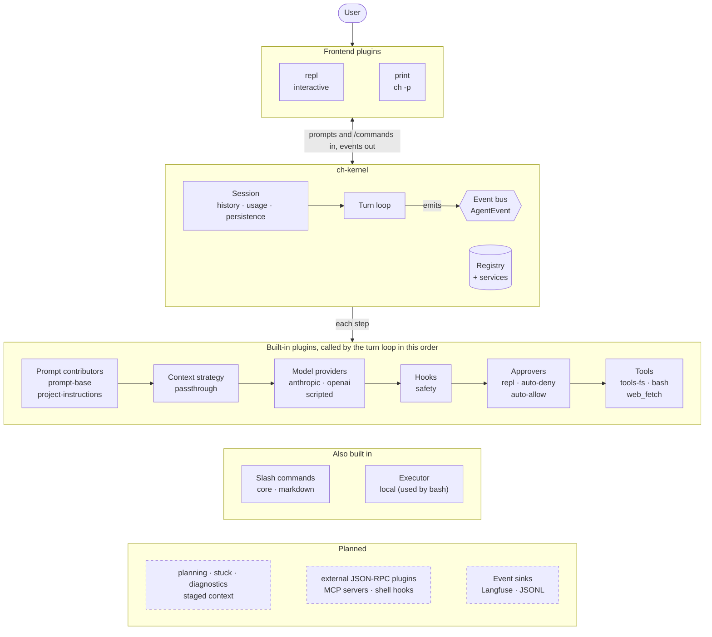

# ch

`ch` is a command-line coding agent written in Rust. It reads your code, runs commands, makes edits and checks its work, in an interactive REPL or as a one-shot headless command.

Almost everything in `ch` is a **plugin**: model providers, tools, safety checks, prompts, slash commands, frontends and context strategies. The core is a small kernel made of the agent loop, an event bus and a plugin registry. You can turn any component on or off in config and compare the agent's behaviour with and without it.

> **Status:** early development. Milestone M1 (a usable CLI agent) is done apart from the REPL's expandable tool output and a live smoke test. Planning, context management, stuck detection, external plugins, MCP and telemetry are next. See [ROADMAP.md](ROADMAP.md) for what is next and [docs/architecture.md](docs/architecture.md) for the design.

## Quick start

`ch` needs Rust 1.88 or newer, plus an Anthropic API key or an OpenAI-compatible endpoint.

```sh
git clone <this repo> && cd coding-harness
cargo build --release -p ch-cli
ln -sf "$PWD/target/release/ch" ~/.local/bin/ch   # or anywhere on your PATH

export ANTHROPIC_API_KEY=sk-ant-...
cd ~/your/project
ch
```

## Usage

### Interactive REPL

```sh
ch                          # start the REPL
ch "explain this repo"      # start the REPL and run a first prompt
ch -c                       # continue the last session in this project
ch -r                       # pick an earlier session to resume
```

While the agent works, you see its text streamed as it arrives, one line per tool call (`● read_file src/main.rs`) and coloured diffs for edits.

| Key | Action |
|---|---|
| Enter | Send |
| Alt-Enter, or a trailing `\` | New line |
| Esc / Ctrl-C (during a turn) | Interrupt the turn and keep the history |
| Ctrl-C twice / Ctrl-D (at the prompt) | Exit |
| Tab | Complete slash commands |

When an action needs approval, answer `y` (yes), `n` (no, optionally with a reason) or `a` (always allow this for the session). After `a`, you can also save the rule to `.ch/config.toml`.

**Slash commands:** `/help`, `/clear`, `/compact`, `/model [id]`, `/cost`, `/tools`, `/plugins`, `/config`, `/resume [id]`, `/exit`.

### Headless mode

`-p` runs one task without interaction. Use it in scripts and CI.

```sh
ch -p "fix the failing test" --permission-mode accept-edits --allow 'bash:cargo test *'
echo "summarize the changes on this branch" | ch -p -
ch -p "list the TODOs" --output-format json
```

| Option | Meaning |
|---|---|
| `--output-format text` | Stream the answer to stdout (the default). Add `--verbose` to also print tool calls to stderr |
| `--output-format json` | Print one JSON result object at the end |
| `--output-format stream-json` | Print every agent event as a JSON line, then the result |
| `--approver auto-deny` | Deny any call that needs approval (the default). The model is told which `--allow` rule would permit it |
| `--approver auto-allow` | Approve everything except the built-in deny list |

The exit code says how the run ended:

| Code | Meaning |
|---|---|
| 0 | Done |
| 1 | Error |
| 2 | Step limit reached |
| 3 | Context overflow |
| 4 | Stopped by a hook |
| 5 | Prompt blocked |
| 130 | Cancelled |

Run `ch --help` for every flag.

## Permissions

Every tool call passes through the `safety` plugin before it runs. Its rules:

- The file tools (`read_file`, `edit_file`, `write_file`, …) can only touch files inside the workspace. Paths that escape it, including through `..` or symlinks, are rejected.
- A file must be read in full before it can be edited. If the file changed on disk since that read (for example, through `bash`), the edit is rejected until the agent reads it again.
- A built-in deny list blocks commands such as `sudo`, `git push`, `git reset --hard`, `rm -rf /` and `curl … | sh`. It guards against accidents; it is not a complete list.
- `web_fetch` follows redirects only within the site you approved, and refuses host names that resolve to private or local addresses (put an IP address or `localhost` in the URL to reach a local server).

> **The permission check is not a sandbox.** With the default local executor, `bash` commands run on your machine as you. Commands on the read-only list run without asking and can read files outside the workspace, and a shell-command check can't foresee every way a program can be made to run another one. To contain what commands can do, run them in a sandbox. [ADR 0001](docs/adr/0001-sandbox-and-agent-security-responsibilities.md) explains which protections come from the sandbox and which from `ch`.

Choose a mode with `--permission-mode` or `plugins.safety.mode`:

| | `ask` (default) | `accept-edits` | `bypass` |
|---|---|---|---|
| Read-only tools and read-only shell commands (`ls`, `rg`, `git status`, …) | run | run | run |
| File edits in the workspace | ask | run | run |
| Edits to `.git/`, `.env*`, `.ch/config.toml` | ask | ask | run |
| Other shell commands | ask | ask | run |
| `web_fetch` | ask per site | ask per site | run |
| Deny list, paths outside the workspace | deny | deny | deny |

Rules look like `tool` or `tool:glob`. For `bash`, the glob is matched against the command. For file tools, it is matched against the path. For `web_fetch`, it is matched against the URL. Precedence is: deny list > `deny` > `ask` > `allow` > mode.

For `bash`, each part of a compound command is checked separately. An allowed `git commit *` doesn't let `git commit -m x && rm -rf src` through.

```toml
[plugins.safety]
mode = "ask"
allow = ["bash:cargo test *", "bash:npm run *", "edit_file:src/**"]
ask = ["bash:git commit *"]
deny = ["web_fetch:http://*"]
```

## Configuration

Config is TOML. Layers are merged in this order, with later layers winning:

1. Built-in defaults
2. `~/.ch/config.toml` (your user config)
3. `.ch/config.toml` in the project
4. `--profile <name>`, which applies `[profiles.<name>]`
5. `--model`, `--set key=value`, `--allow`, `--permission-mode`

Tables merge key by key. Lists are replaced, not appended, except that a project's `plugins.safety.deny` and `ask` rules are added to yours.

**Project config needs your trust for some settings.** A `.ch/config.toml` comes with the repository, so it may only set what can't loosen permissions, run commands, read files outside the project or send your API key elsewhere: `[model]`, `[agent]`, `plugins.safety.deny` and `ask` (which add to yours), and the plugin settings each plugin declares safe, such as timeouts and size limits. Everything else needs your trust first, including `plugins.safety.mode` and `allow`, `plugins.enable` and `disable`, `select.*`, provider `base_url` and `api_key_env`, paths, commands, and settings for plugins that aren't built in. In the REPL, `ch` shows these settings with their values and asks once; you're asked again whenever any of them changes. Rules you save with "always allow" don't trigger the question. Headless runs ignore untrusted settings with a warning; pass `--trust-project` to apply them for that run. Trust is recorded in `~/.ch/trusted-projects.toml`.

```toml
[model]
provider = "anthropic"            # or "openai"; unset: the first enabled provider
id = "claude-opus-5-5"            # unset: the provider's default (openai has none)
max_output_tokens = 16384
# context_window = 200000         # overrides what the provider reports
# [model.pricing]                 # USD per million tokens, used by /cost
# input = 5.0
# output = 25.0

[agent]
max_steps = 300                   # model calls per turn
tool_result_max_chars = 24000

[plugins]
disable = ["tool-web-fetch"]      # turn plugins off
enable = []                       # turn on plugins that are off by default

# OpenAI-compatible endpoints (OpenAI, OpenRouter, vLLM, SGLang):
[plugins.provider-openai]
base_url = "http://localhost:8000/v1"
api_key_env = "OPENAI_API_KEY"

[profiles.cheap.model]
id = "claude-haiku-5-5"
```

Each plugin reads its own `[plugins.<id>]` section. Two useful commands:

- `ch --list-plugins` shows which plugins are loaded, why, and what each registers.
- `ch --config-path` shows where config, sessions and logs live.

Set `CH_HOME` to use a directory other than `~/.ch`, and `CH_LOG=debug` for verbose logs in `~/.ch/logs/`.

### Project instructions and custom commands

- **Instructions:** `CH.md` and `AGENTS.md` files from the git root down to the workspace, plus `~/.ch/CH.md`, are added to the system prompt. Use them for build and test commands, conventions and things to avoid.
- **Custom commands:** each markdown file in `.ch/commands/` or `~/.ch/commands/` becomes a slash command. `.ch/commands/review.md` becomes `/review`. `$ARGUMENTS` is replaced by whatever you type after the command, and optional front matter sets the description:

  ```markdown
  ---
  description: Review the current diff
  ---
  Review `git diff` for bugs and risky changes. Focus on: $ARGUMENTS
  ```

## Architecture



The kernel has no concrete providers, tools, prompts or UI. [docs/architecture.md](docs/architecture.md) has more diagrams: one turn step by step, and how the crates depend on each other.

| Crate | What it does |
|---|---|
| `crates/ch-kernel` | Conversation types, plugin traits, registry, config, event bus, sessions, turn loop |
| `crates/ch-cli` | The `ch` binary: config layering, plugin wiring, session store, logging |
| `crates/ch-testkit` | Test helpers and the tool conformance suite |
| `plugins/provider-anthropic` | Anthropic Messages API: streaming, retries, prompt caching, extended thinking |
| `plugins/provider-openai` | OpenAI-compatible chat completions |
| `plugins/provider-scripted` | Replays a canned script, for deterministic tests |
| `plugins/safety` | Path guard, read-before-write tracking, permission policy |
| `plugins/tools-fs` | `read_file`, `edit_file`, `write_file`, `list_files`, `glob_files`, `grep_text` |
| `plugins/tool-bash` | The `bash` tool (with a bash-only variant when the file tools are off) |
| `plugins/tool-web-fetch` | The `web_fetch` tool: fetches pages and converts HTML to markdown |
| `plugins/executor-local` | Runs commands in their own process group, with timeout and cancellation |
| `plugins/prompt-base` | System prompt and a tool-usage block that matches the enabled tools |
| `plugins/project-instructions` | `CH.md` / `AGENTS.md` and an environment block |
| `plugins/commands-core`, `commands-markdown` | Built-in and markdown slash commands |
| `plugins/frontend-repl`, `frontend-print` | The interactive REPL and the headless `-p` frontend |

The other crates under `plugins/` are placeholders for upcoming phases: planning, context management, stuck detection, diagnostics, MCP, external plugins, shell hooks, telemetry and a Docker executor.

### Writing a plugin

A plugin implements `ch_kernel::Plugin` and registers what it provides:

```rust
use std::sync::Arc;
use ch_kernel::{Cx, Plugin, PluginManifest, RegisterCx, Tool, ToolOutput, ToolSpec};
use serde_json::{Value, json};

struct Hello;

#[async_trait::async_trait]
impl Tool for Hello {
    fn spec(&self) -> ToolSpec {
        ToolSpec {
            name: "hello".into(),
            description: "When: … Protocol: … Error modes: … Side effects: none.".into(),
            input_schema: json!({"type": "object", "properties": {"name": {"type": "string"}}}),
            read_only: true,
        }
    }
    async fn call(&self, input: Value, _cx: &Cx) -> ToolOutput {
        ToolOutput::ok(format!("hello, {}", input["name"].as_str().unwrap_or("world")))
    }
}

pub struct HelloPlugin;

impl Plugin for HelloPlugin {
    fn manifest(&self) -> PluginManifest {
        PluginManifest::new("hello", "Says hello")
    }
    fn register(&self, cx: &mut RegisterCx<'_>) -> anyhow::Result<()> {
        cx.add_tool(Hello);
        Ok(())
    }
}
```

Add the plugin to `builtin_plugins()` in [crates/ch-cli/src/plugins.rs](crates/ch-cli/src/plugins.rs) behind a cargo feature.

Other extension points work the same way: hooks (`add_hook`), prompt contributors, slash commands, event sinks, executors, approvers, frontends and shared services. The hook semantics are documented in [crates/ch-kernel/src/hook.rs](crates/ch-kernel/src/hook.rs).

## Development

```sh
cargo test --workspace                              # all tests
cargo clippy --workspace --all-targets -- -D warnings
cargo fmt --all
cargo run -p ch-cli -- --list-plugins
```

The [justfile](justfile) wraps these commands: `just fmt`, `just lint`, `just test`, `just run`, and `just msrv`, which builds with the oldest supported Rust (1.88). CI runs fmt, clippy and the tests on Linux and macOS, and checks that the workspace still builds with Rust 1.88.

Tests use fake plugins and a scripted model, so they need no API key. The end-to-end tests in [crates/ch-cli/tests/e2e.rs](crates/ch-cli/tests/e2e.rs) run the real binary against the fixture repo in [tests/fixtures/calc-py](tests/fixtures/calc-py). One of them snapshots the full prompt sent to the model. After an intentional prompt change, review the new snapshot with `cargo insta review`; [docs/snapshot-testing.md](docs/snapshot-testing.md) explains how snapshots work.

Tests that call the real Anthropic and OpenAI APIs are marked `#[ignore]`. With API keys set, run them with `cargo test -- --ignored`.
