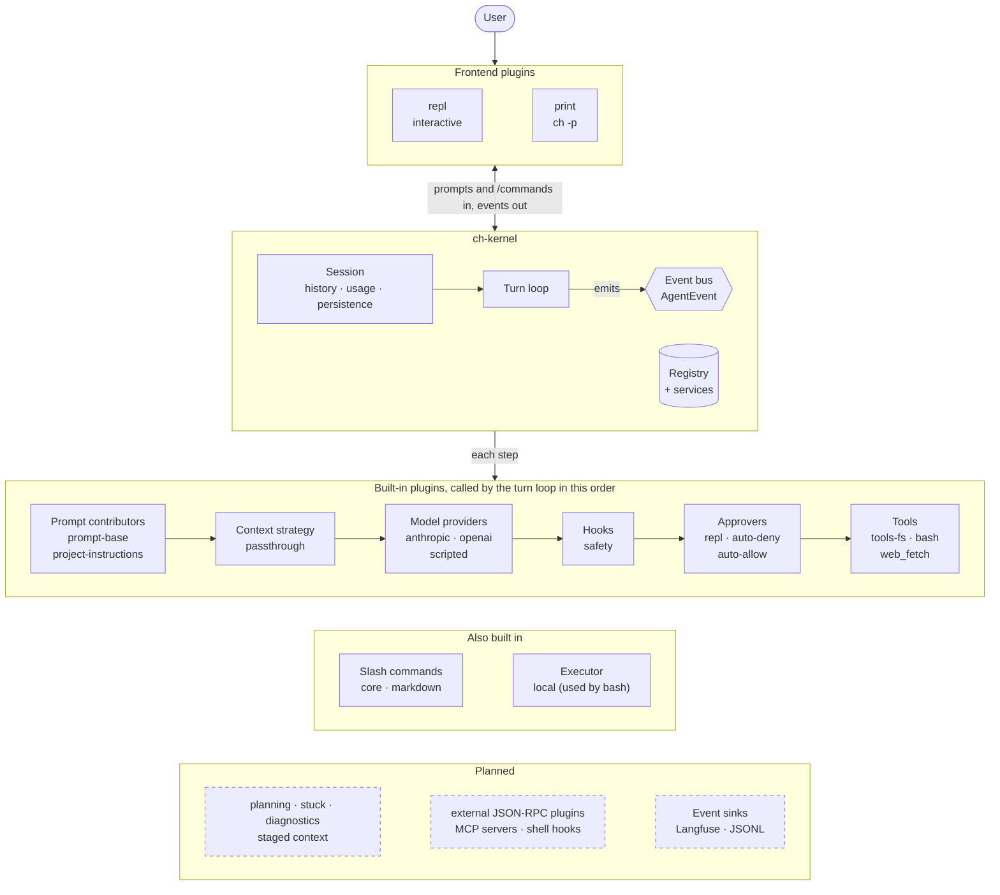
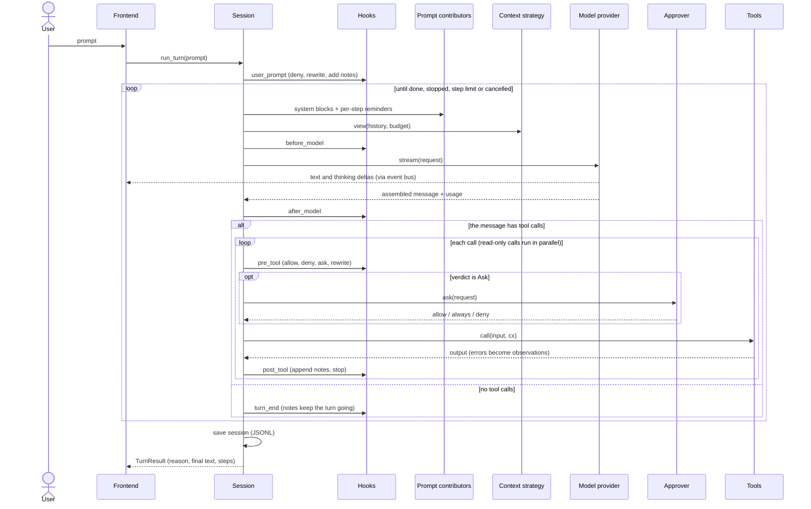
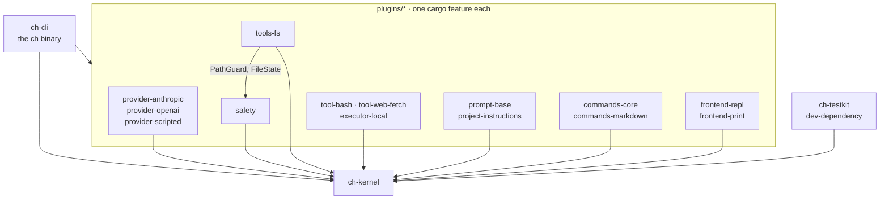

# Architecture

How `ch` is put together: the kernel, its extension points, configuration, the crate layout and the design defaults. For what's built and what's next, see [ROADMAP.md](../ROADMAP.md).

## 1. Kernel and plugins

The kernel owns the session, the turn loop, the plugin registry and the event bus. Everything else is a plugin. Solid boxes are built today; dashed boxes are planned.



One user turn, step by step. The loop repeats until the model stops calling tools, a hook stops the turn, the step limit is reached or the user cancels.



**Rule:** the kernel has **no** concrete providers, tools, prompts or UI. If the kernel ever needs to know about a specific tool, that design is wrong.

## 2. Extension points

| Extension point | How many active | Kernel trait (sketch) | Built-in plugins |
|---|---|---|---|
| **ModelProvider** | 1 per role (agent, summarizer) | `stream(req, cancel) -> Stream<ModelEvent>` | `provider-anthropic`, `provider-openai` |
| **Tool** | many | `spec() -> ToolSpec`, `call(input, &ToolCx) -> ToolOutput` | `tools-fs`, `tool-bash`, `tool-web-fetch`, `planning` (`update_plan`) |
| **Hook** | many, ordered by priority | `on(&HookEvent, &Cx) -> HookDecision` | `safety` (permissions), `stuck`, `diagnostics`, `hooks-shell` |
| **PromptContributor** | many, ordered | `system_blocks(cx)`, `turn_reminders(cx)` | `prompt-base`, `project-instructions`, `planning` |
| **ContextStrategy** | 1 | `view(&History, Budget, cx) -> View` | `context` (`none` / `elide` / `summarize` / `staged`) |
| **Command** (slash) | many | `name()`, `run(args, &CmdCx) -> Outcome` | `commands-core`, `commands-markdown` |
| **EventSink** | many | `handle(&AgentEvent)`, `flush()` | `telemetry-langfuse`, `telemetry-jsonl` |
| **Executor** | 1 | `run(cmd, cwd, timeout, cancel) -> ExecResult` | `executor-local`, `executor-docker` |
| **Approver** | 1 (usually from the frontend) | `ask(&ApprovalRequest) -> Approval` | `repl` (interactive), `auto-deny`, `auto-allow` |
| **Frontend** | 1 | `run(SessionHandle) -> Result<()>` | `repl`, `print` (headless/JSON), later `tui` |
| **Service** | many, typed | shared state such as `FileState`, `PlanStore`, `PathGuard` | provided and consumed by plugins |

**Plugin trait:**

```rust
pub trait Plugin: Send + Sync {
    fn manifest(&self) -> PluginManifest;    // id, version, api_version, description, requires/provides
    fn register(&self, cx: &mut RegisterCx) -> anyhow::Result<()>;
    // RegisterCx: cx.config::<T>()?, cx.add_tool(..), cx.add_hook(..), cx.provide_service(..), ...
}
```

## 3. Three ways to extend

| Tier | Mechanism | Who it's for | Can provide |
|---|---|---|---|
| **1. Built-in** | Rust crates implementing kernel traits, compiled in, each behind a cargo feature | Core features, best performance | Anything |
| **2. External** | Any executable speaking **JSON-RPC 2.0 over stdio** (`plugin.toml` + a command). Any language. Runs in its own process, so a crash never takes down the agent | Third-party or personal plugins | Tools, hooks, prompt contributions, slash commands, event subscriptions |
| **3. Lightweight** | **MCP servers** (tools, via `rmcp`), **shell hooks** (a command gets JSON on stdin and decides by exit code or JSON output) and **markdown commands** (`.ch/commands/*.md`) | Power users, existing ecosystems | Tools, hooks, prompt commands |

Not doing: Rust dynamic libraries (`dlopen`), because Rust has no stable ABI and they're unsafe. **WASM components** (wasmtime + WIT) could be added later for sandboxed in-process plugins. Background: [rust-libraries-and-plugin-loading.md](rust-libraries-and-plugin-loading.md).

## 4. Harness components as plugins

| Component | Plugin(s) | Switch |
|---|---|---|
| Action space: full tools vs bash-only | `tools-fs` + `tool-web-fetch` on or off; `prompt-base` variant | `plugins.disable = ["tools-fs","tool-web-fetch"]` |
| Planning | `planning` (tool + system block + per-turn plan reminder) | enable or disable `planning` |
| Context management | `context` with `strategy = "staged"` and so on | `[plugins.context] strategy = ...` |
| Safety gates | `safety` (path guard, read-before-write, permission policy) | always on |
| Post-edit diagnostics | `diagnostics` (post_tool hook) | enable or disable |
| Stuck detection | `stuck` (hook: reminder, refusal, stop) | enable or disable |

## 5. Config and file locations

- Config merges in this order: built-in defaults → `~/.ch/config.toml` → `.ch/config.toml` (project) → `--profile <name>` → CLI flags.
- Project config settings that could loosen permissions, run commands, read paths or pick endpoints and credentials apply only after the user trusts them; trust is recorded per workspace for the exact values (`crates/ch-cli/src/trust.rs`, [ADR 0001](adr/0001-sandbox-and-agent-security-responsibilities.md)).
- *(Planned, roadmap 7.2 and 7.6)* Plugins load from `~/.ch/plugins/*/plugin.toml` and `.ch/plugins/*/plugin.toml`. Project plugins need a one-time trust prompt.
- Project instructions are read from `CH.md` / `AGENTS.md` in the repo root, and in parent directories up to the git root.
- Sessions are stored in `~/.ch/sessions/<project-hash>/<session-id>.jsonl`.

```toml
[model]
provider = "anthropic"          # which ModelProvider plugin
id = "..."
[model.summarizer]              # optional separate model for context summaries
provider = "anthropic"
id = "..."

[plugins]
enable  = ["tools-fs", "tool-bash", "tool-web-fetch", "planning", "context", "stuck", "diagnostics", "telemetry-langfuse"]
disable = []

[plugins.context]
strategy = "staged"             # none | elide | summarize | staged
soft = 0.60
hard = 0.85
recent = 0.30

[[mcp_servers]]
name = "github"
command = "github-mcp"

[[hooks]]                        # handled by the hooks-shell plugin
event = "post_tool"
match = { tool = "edit_file", path = "*.rs" }
command = "cargo fmt -- {path}"
```

## 6. Crate layout

```
coding-harness/
├── Cargo.toml                       # workspace
├── crates/
│   ├── ch-kernel/                   # types, events, plugin traits, registry, session, turn pipeline
│   ├── ch-plugin-protocol/          # JSON-RPC message types for external plugins (shared)
│   ├── ch-plugin-sdk/               # helper crate for writing external plugins in Rust
│   ├── ch-cli/                      # the `ch` binary: config loading, plugin wiring, picks frontend
│   ├── ch-eval/                     # eval runner (headless frontend + matrix over plugin configs)
├── plugins/
│   ├── provider-anthropic/   provider-openai/    provider-scripted/ (tests)
│   ├── tools-fs/             tool-bash/          tool-web-fetch/
│   ├── safety/               stuck/              diagnostics/       planning/
│   ├── context/              prompt-base/        project-instructions/
│   ├── commands-core/        commands-markdown/
│   ├── executor-local/       executor-docker/
│   ├── frontend-repl/        frontend-print/     (later) frontend-tui/
│   ├── mcp-bridge/           external-host/      hooks-shell/
│   └── telemetry-langfuse/   telemetry-jsonl/
├── prompts/                         # prompt templates used by prompt-base, planning, context, stuck
├── examples/plugins/                # sample external plugins (Python + Rust)
└── tests/fixtures/                  # toy repos for end-to-end tests
```

Each plugin crate depends only on `ch-kernel` (plus `tools-fs` on `safety`, whose services it uses). `ch-cli` links the plugins in, one cargo feature each. Plugins find each other at runtime through the registry, not through crate dependencies: `tool-bash`, for example, gets its executor from `Cx::executor`.



## 7. Main crates

`tokio`, `tokio-util` (cancellation), `futures`, `async-trait`, `serde`/`serde_json`, `schemars`, `toml`, `thiserror`/`anyhow`, `clap`, `reqwest` (rustls, streaming), `eventsource-stream` (SSE), `reedline` (line editor), `crossterm`, `indicatif`, `termimad` (markdown in the terminal), `similar` (diffs), `ignore`, `globset`, `grep-regex`/`grep-searcher`, `sha2`, `htmd`, `rmcp` (MCP), `opentelemetry` + `opentelemetry-otlp` + `tracing-opentelemetry` (Langfuse), `tracing`, `tempfile`, `insta`.

## 8. Design defaults

These are starting values. Every one is a config setting, and the eval runner ([roadmap](../ROADMAP.md) Phase 9) is how we tune them per model.

| Setting | Default |
|---|---|
| Max steps per turn | 300 |
| Output cap per model call | 16,384 tokens |
| Tool result truncation | 24k chars (keep head and tail) |
| Parallel read-only tool calls | up to 8 |
| Context: soft threshold (elide) | 0.60 × usable window |
| Context: hard threshold (summarize) | 0.85 × usable window |
| Context: verbatim recent window | 0.30 × window, at least 2 turns |
| Stuck: reminder / refuse / stop / malformed | 5 identical calls / after 2 identical failures with the same error / 8 identical calls failed or refused / 3 responses with only malformed calls |
| Bash timeout | 120s default, 600s max |

**Context strategies** (`plugins.context.strategy`):

| Strategy | Elide bulky tool output | Summarize old turns |
|---|---|---|
| `none` | – | – |
| `elide` | ✓ | – |
| `summarize` | – | ✓ |
| `staged` (default) | ✓ first | ✓ if still over the hard threshold |

- History is split into a **preamble** (system + first task, always verbatim), a **recent window** (verbatim) and the **middle**.
- Above `soft`, bulky tool outputs in the middle become a stub: `[tool output elided: {N} lines / {M} chars. Re-read or re-run to get it again.]`. Elision is free, so it should absorb most of the pressure before the paid summary call runs.
- Above `hard`, the oldest middle events are summarized by a separate tool-free call and inserted as `<context-summary>` right after the preamble. The summary is **updated incrementally**, not regenerated. Headings: `Goal / Files touched / Done / Pending / Errors & fixes / Current state / Next step`, keeping exact paths, function names and error strings.
- No recall tool: the stub tells the model to re-read or re-run instead. Elided originals are still written to the session directory for debugging and telemetry.

**Planning:** an `update_plan(plan)` tool. Each item has `content`, `status` (`pending | in_progress | completed`) and `activeForm`. The complete list is re-sent on every update and exactly one item is `in_progress`. The current plan is kept outside the history (the `PlanStore` service, saved as `plan.json` next to the session) and injected as a `<system-reminder>` on the first model call of each turn; while no step is open, that reminder is a one-line nudge to plan multi-step work instead. The tool result is only a count, but each `update_plan` call stays in the history with its full list, so superseded calls are something context management (6.4) should elide first.

**Tools:**

| Tool | Read-only | Key behavior |
|---|---|---|
| `read_file(path, offset, limit)` | ✓ | Line-numbered output. Records a `full_read` only when the whole file was read |
| `edit_file(path, old_text, new_text, replace_all)` | | Exact-match string replace. Must be unique unless `replace_all`. Returns a diff. Requires a prior full read |
| `write_file(path, content, overwrite)` | | New files freely. Overwriting needs `overwrite=true` and a prior full read |
| `list_files(path, recursive)` | ✓ | Tree with sizes. Caps entries. Filters `.git`, `node_modules`, `.venv`, `__pycache__`, `target` |
| `glob_files(pattern, path)` | ✓ | Files only. No match returns empty, not an error |
| `grep_text(query, path, include)` | ✓ | ripgrep-backed. Output as `path:line:text`. Skips binaries |
| `bash(command, timeout_seconds, cwd)` | | `/bin/sh -c`. A nonzero exit sets `is_error`. Deny list (`rm -rf /`, `sudo`, `git push`, `reset --hard`…) |
| `web_fetch(url, format)` | ✓ | HTML converted to markdown. Size cap. HTTP errors become recoverable errors. Same-site redirects only; names that resolve to private addresses are refused |
| `update_plan(plan)` | | From the `planning` plugin |

- Tool descriptions state **When / Protocol / Error modes / Side effects**. Every error message suggests the fix (for example, "is a directory → use list_files").
- **Bash-only mode:** the file and search tools are removed, the prompt gets a "Working with only a shell" block, and it tells the model that nothing validates its edits, so it should read the file back after changing it.
- Files changed through `bash` must not bypass read-before-write: the content hash is re-checked at edit time.

**Safety (always on):** see [ADR 0001](adr/0001-sandbox-and-agent-security-responsibilities.md) for what the agent protects and what a sandbox must. A path guard (resolve symlinks, reject anything outside the workspace root); a file-state tracker `{path: (hash, full_read)}` that rejects edits to files never fully read or changed since the last read; an allow / ask / deny permission layer (read-only commands such as `git status/diff/log`, `ls`, `rg`, `cat` are allowed, destructive ones denied); tool errors returned as observations so the loop never crashes.

**Telemetry per run:** success, cost (tokens × price), turns, tool calls, **termination reason** (done / step limit / overflow / stopped by a hook, such as `stuck` / cancelled / error), peak context ÷ window, elision and summary counts, whether any file was edited, and how many times an already-edited file was re-patched.

## 9. Testing strategy

- **Kernel:** fake plugins only, to prove the kernel doesn't depend on any concrete plugin.
- **Plugins:** unit tests for each plugin, plus the shared conformance suites for Tools, Hooks and Providers.
- **End to end:** `provider-scripted` + `frontend-print` + fixture repos; prompt snapshots with `insta`.
- **Live:** `#[ignore]` tests run with API keys; small and cheap.
- **Evals:** the eval suite ([roadmap](../ROADMAP.md) Phase 9) is the regression check for changes to prompts or plugins.
